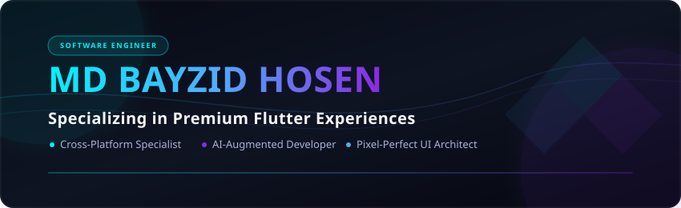

  

  &nbsp;
  &nbsp;
  &nbsp;
  

---

### 👨‍💻 About Me

Hi there! 👋 I'm **MD Bayzid Hosen**, a passionate **Software Engineer** specializing in **Flutter & Mobile App Development** based in Dhaka, Bangladesh.

- 📱 Crafting scalable, high-performance cross-platform mobile apps with pixel-perfect UI.
- ⚡ Experienced in **Flutter, Dart, GetX, REST API Integration, and Firebase**.
- 🤖 Embracing **AI-Augmented Development** to accelerate workflow, architecture, and code quality.
- 🚀 Expanding into backend architecture with **Node.js, Express, and MongoDB** to build complete full-stack systems.

---

### 🚀 Featured Projects

<table>
  <tr>
    <td width="50%" valign="top">
      <h3 align="center">📱 WhichWin — Decision Maker App</h3>
      

        
      

      

        A beautifully crafted Flutter application that helps users make decisions effortlessly. Features fluid animations, clean architecture, and GetX state management.
      

      

        
        
        
      

    </td>
    <td width="50%" valign="top">
      <h3 align="center">🌐 Personal Portfolio</h3>
      

        
      

      

        A sleek, modern portfolio website deployed on Vercel. Showcases my projects, tech stack, and professional milestones.
      

      

        
        
        
      

    </td>
  </tr>
</table>

  

---

### 🛠️ Tech Stack & Tools

  

---

### 📊 GitHub Analytics

  
  

  

---

  Designed with ❤️ by <a href="https://github.com/mdbayzid131">MD Bayzid Hosen</a>

